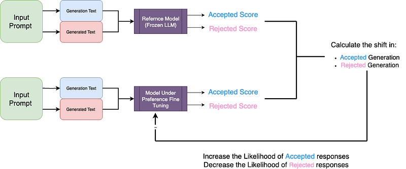
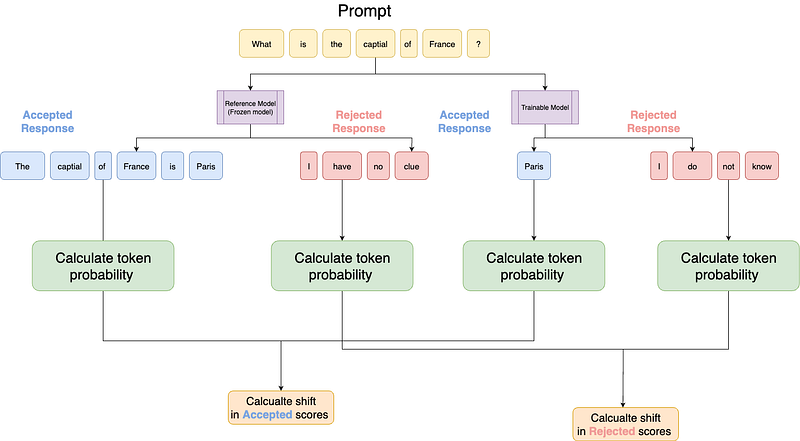
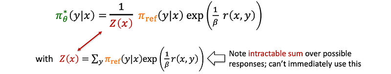
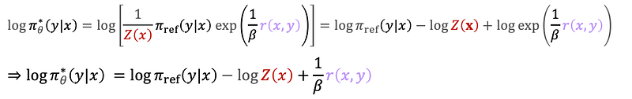
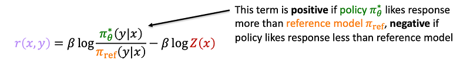
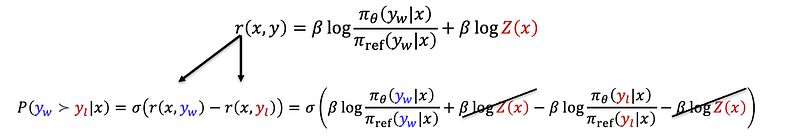
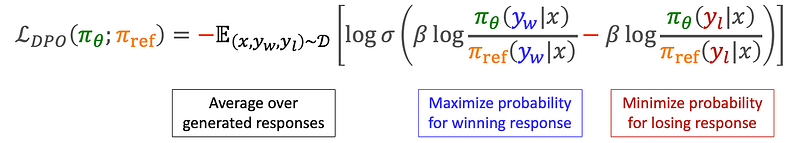
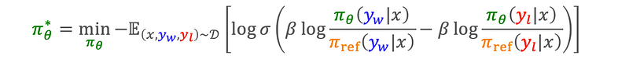
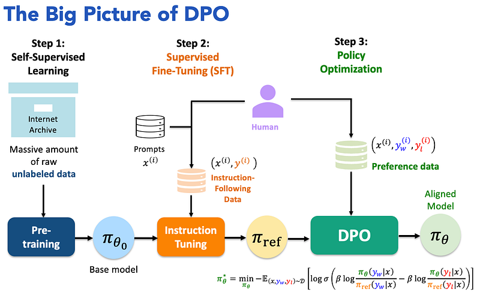
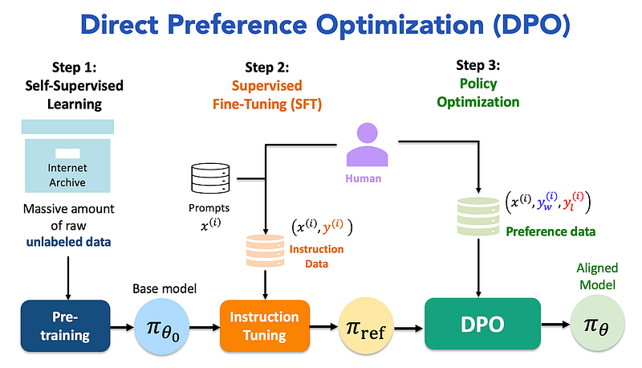

# Original archive draft

Original wording, equations and citation markers, retained for comparison.

## Hands-On LLM Preference Tuning With PPO & DPO [2/2]

## Direct Preference Optimization (DPO)

Direct Preference Optimization (DPO) addresses these limitations by reformulating the problem. DPO leverages a key insight: the existence of a closed-form optimal policy as a function of the reward:

where β is the temperature term trading off the reward and the KL constraint, and Z(x) is the partition function. This equation represents a Boltzmann distribution, where the probabilities of responses are upgraded by the exponentiated reward.

### Rewriting the Reward Function

Suppose that somehow, we have access to an optimal policy π*_θ(y|x) … how would the reward function r(x,y) be for such an optimal policy?

By rearranging the terms, we can rewrite the reward function in terms of the optimal policy:

This equation reveals a crucial insight: if an optimal policy puts more probability on a response than the reference distribution, the reward is higher. Conversely, if the probability is lower, the reward is lower.

### The DPO Loss Function

To make this approach practical, we need to eliminate the intractable partition function Z(x). We achieve this by plugging the rewritten reward function into the reward modeling loss.

Specifically, we compute the difference between the rewards of the preferred response and the dispreferred response:

By canceling out the partition function Z(x), we obtain the final DPO loss function:

This loss function encourages the model to assign higher probabilities to preferred responses and lower probabilities to dispreferred responses, effectively fine-tuning the language model according to human preferences.

This approach enables the direct optimization of the policy π_θ without requiring explicit reward calculations or the use of reinforcement learning algorithms. Ultimately, the DPO objective can be expressed as a constrained optimization problem, eliminating the need to train a reward model.

### Advantages of DPO:

1. Simplicity: DPO eliminates the need for a separate reward model and RL training loop.
1. Stability: The direct optimization approach tends to be more stable than RLHF.
1. Efficiency: DPO is computationally lightweight compared to RLHF.
1. Performance: In controlled experiments, DPO has been shown to achieve similar or better performance than RLHF across various tasks.

### Experimental Results:

1. Sentiment Control: In a controlled experiment maximizing positive sentiment in movie reviews, DPO achieved a better reward/KL divergence trade-off compared to RLHF (PPO).
1. Summarization: For Reddit post summarization tasks, DPO demonstrated more robust performance across different sampling temperatures compared to RLHF.
1. Single-turn Dialogue: DPO provided similar or better performance to computationally demanding baselines in generating engaging and helpful responses to human queries.

### Direct Preference Optimization (DPO)

Direct Preference Optimization (DPO) has emerged as a more recent and streamlined alternative to PPO for preference tuning.[12][13] As its name suggests, DPO directly optimizes the language model based on preference data, bypassing the need for a separate reward model and the complexities of reinforcement learning.[7][14]

How DPO Works:

The key insight behind DPO is that the LLM itself can be implicitly used as a reward model.[13][15] DPO works directly with a dataset of triplets: a prompt, a “chosen” (preferred) response, and a “rejected” (less preferred) response.[3][13] The goal is to fine-tune the LLM to increase the likelihood of the chosen response and decrease the likelihood of the rejected one.[16]

This is achieved through a specific loss function derived from the Bradley-Terry model, which models the probability of one item being preferred over another.[12]

The DPO loss function directly encourages the model to assign a higher probability to the preferred responses compared to the rejected ones.[13] A hyperparameter, β, controls how much the model’s policy is allowed to change from its initial state, which helps in preventing the model from deviating too far from its original knowledge base.[14][17]

Advantages of DPO:

- Simplicity: DPO simplifies the preference tuning pipeline by eliminating the need to train a separate reward model and use a complex RL algorithm.[7][12]
- Efficiency: By having a single training stage, DPO is more computationally efficient and faster to train than PPO.[7][10]
- Stability: The direct optimization process of DPO is generally more stable than the iterative nature of PPO.[12][18]

Challenges of DPO:

- Bias Sensitivity: DPO’s performance is highly dependent on the quality of the preference data, and it can amplify any biases present in that data.[7]
- Out-of-Distribution Inputs: It may struggle with inputs that are significantly different from those in its training data.[7]

##

## Original exported link targets

- 12: https://www.google.com/url?sa=E&q=https%3A%2F%2Fvertexaisearch.cloud.google.com%2Fgrounding-api-redirect%2FAUZIYQGZ0Y2Shxc_Ep5KXHyGxWGZamvmvqa2QByeFQpWzbsblAsbukUFpJfFkWLPNtnAFlqUXU8tARqTxn70RjBx6fDmp9TEk2HUtOZbFPZAs_BrliFtKEVfffQzPcxE95D-rRCbiaeQcbN4QOiaPB8U3HaB8yH8RI36dYy_ftSv33Yky_pp1IhMqO_RATM6lm2t8MdYF1rGeFkR
- 13: https://www.google.com/url?sa=E&q=https%3A%2F%2Fvertexaisearch.cloud.google.com%2Fgrounding-api-redirect%2FAUZIYQHgz2zmbd4d80kGDb39OzLDSW1DRGmmmVWg1Sp0B_hwhDsxzkHe5dcQQfcqXMWaWX4s74cFAlINkVznICreTbFaJHCLg2Xj478AsKnEdBWqtffFZddqvliJUjcN3EFcO_3R-bMZbA9T_RNxMNQS0cDGGvHc6_6jDW6OmG5wUlpdKuCEfDM7qP0%3D
- 7: https://www.google.com/url?sa=E&q=https%3A%2F%2Fvertexaisearch.cloud.google.com%2Fgrounding-api-redirect%2FAUZIYQFmGxJoXWzT4_PbGlSMb5lFPgyBq-qT2MTDAF4iN5nJw-HrQvMpw7S46lzP8u3qLbD0_KHZq64IIibDlhxOwGwsCAGZjwVZ9c_8GFQ5vHFs49O22v0pJ_4ouEbU5t9jZX0A-0uBcHOpC6r5aVpff4aGWcRzR0slDRq6yHqrewYJje-Bf3ap1wuJOGbD0tH2LDmYTbd5AzEv7-gJzLuQ81EXXKyKksiYXQZdwkrKoKd_AOQG
- 14: https://www.google.com/url?sa=E&q=https%3A%2F%2Fvertexaisearch.cloud.google.com%2Fgrounding-api-redirect%2FAUZIYQGBqL6J7GMLPgrLej93x8oTLCzUu1gn999eBeMH4QgMKXY6rkxuAceZPEYj2_RGGvkLQymlzEn8KYoEgUD9FkKELOKhoWLFy_MkVKQA7L6i5jP3Tyw3F63lxXnu0tHveqS1RO50Qh5PzJe5_0tWvXxYpzqfW0Qv4j93
- 13: https://www.google.com/url?sa=E&q=https%3A%2F%2Fvertexaisearch.cloud.google.com%2Fgrounding-api-redirect%2FAUZIYQHgz2zmbd4d80kGDb39OzLDSW1DRGmmmVWg1Sp0B_hwhDsxzkHe5dcQQfcqXMWaWX4s74cFAlINkVznICreTbFaJHCLg2Xj478AsKnEdBWqtffFZddqvliJUjcN3EFcO_3R-bMZbA9T_RNxMNQS0cDGGvHc6_6jDW6OmG5wUlpdKuCEfDM7qP0%3D
- 15: https://www.google.com/url?sa=E&q=https%3A%2F%2Fvertexaisearch.cloud.google.com%2Fgrounding-api-redirect%2FAUZIYQHx8NZ3bk2mxY3Yba-afNF7gDUmAIZ3jR6eq9UK-vZRoXFxx6N_t_4Pbl3VyaIgX8DPIWEEfsswTVxZBqUcOmbAsA_9ZM0rMLAYB4M447M0oKNA1X3lDksimYL__BLw80r18eh6wrkEazwA5lnenUQHiqctXsoRHGGRfypCJNec
- 3: https://www.google.com/url?sa=E&q=https%3A%2F%2Fvertexaisearch.cloud.google.com%2Fgrounding-api-redirect%2FAUZIYQHOhT41kk_ZHOJjVLP90fjBPbWwo2RvkWYxZTSh59YFCvR6gtx4Cu0ipLsy_pYa_m5CTnk-4hzglVZUqqm9JNXo5Eg49rwCtDS5uFFqjRcZNI2wKoXOAKMDxl4JRRg88cjsZNW5uyouevx_MO2bKbssRsFXdR9O57tAgeYOWoKWdkLuawUK7t5306oYHe979FeqFIUmSXplXqcV3Ak3oChlP-OdxA90FPyDOreyQY66f5AU
- 13: https://www.google.com/url?sa=E&q=https%3A%2F%2Fvertexaisearch.cloud.google.com%2Fgrounding-api-redirect%2FAUZIYQHgz2zmbd4d80kGDb39OzLDSW1DRGmmmVWg1Sp0B_hwhDsxzkHe5dcQQfcqXMWaWX4s74cFAlINkVznICreTbFaJHCLg2Xj478AsKnEdBWqtffFZddqvliJUjcN3EFcO_3R-bMZbA9T_RNxMNQS0cDGGvHc6_6jDW6OmG5wUlpdKuCEfDM7qP0%3D
- 16: https://www.google.com/url?sa=E&q=https%3A%2F%2Fvertexaisearch.cloud.google.com%2Fgrounding-api-redirect%2FAUZIYQEYpu1cwXUyiRFWbm4pxfVHkrBC9BM2wulj-q7bRnzz8S8hIdQSgtTT2BOcA3jxSfwRBmS3sulMjCDrodOWlTBav6AUQpUov2jS0ggXRYHDXzWgfrtgrI0mn5mpJOmeRjWF-4r5b-2zFpKtd31usdxXtQFXp1AA8G0D-aX9dSiYkurePNtOudddjstIe9gXorh5fcOO
- 12: https://www.google.com/url?sa=E&q=https%3A%2F%2Fvertexaisearch.cloud.google.com%2Fgrounding-api-redirect%2FAUZIYQGZ0Y2Shxc_Ep5KXHyGxWGZamvmvqa2QByeFQpWzbsblAsbukUFpJfFkWLPNtnAFlqUXU8tARqTxn70RjBx6fDmp9TEk2HUtOZbFPZAs_BrliFtKEVfffQzPcxE95D-rRCbiaeQcbN4QOiaPB8U3HaB8yH8RI36dYy_ftSv33Yky_pp1IhMqO_RATM6lm2t8MdYF1rGeFkR
- 13: https://www.google.com/url?sa=E&q=https%3A%2F%2Fvertexaisearch.cloud.google.com%2Fgrounding-api-redirect%2FAUZIYQHgz2zmbd4d80kGDb39OzLDSW1DRGmmmVWg1Sp0B_hwhDsxzkHe5dcQQfcqXMWaWX4s74cFAlINkVznICreTbFaJHCLg2Xj478AsKnEdBWqtffFZddqvliJUjcN3EFcO_3R-bMZbA9T_RNxMNQS0cDGGvHc6_6jDW6OmG5wUlpdKuCEfDM7qP0%3D
- 14: https://www.google.com/url?sa=E&q=https%3A%2F%2Fvertexaisearch.cloud.google.com%2Fgrounding-api-redirect%2FAUZIYQGBqL6J7GMLPgrLej93x8oTLCzUu1gn999eBeMH4QgMKXY6rkxuAceZPEYj2_RGGvkLQymlzEn8KYoEgUD9FkKELOKhoWLFy_MkVKQA7L6i5jP3Tyw3F63lxXnu0tHveqS1RO50Qh5PzJe5_0tWvXxYpzqfW0Qv4j93
- 17: https://www.google.com/url?sa=E&q=https%3A%2F%2Fvertexaisearch.cloud.google.com%2Fgrounding-api-redirect%2FAUZIYQEm-kYdJ2IwusTsvXsz4SlfIChmavDb_GbkOSegiDvY3HGIpRzUNIRNe6M24ORVzkA2rTkfecaTd67EC9vkAbQLCypmnwo5uZF0GD1F6NJKkvjBJEpQYnQA700tb0170Scn
- 7: https://www.google.com/url?sa=E&q=https%3A%2F%2Fvertexaisearch.cloud.google.com%2Fgrounding-api-redirect%2FAUZIYQFmGxJoXWzT4_PbGlSMb5lFPgyBq-qT2MTDAF4iN5nJw-HrQvMpw7S46lzP8u3qLbD0_KHZq64IIibDlhxOwGwsCAGZjwVZ9c_8GFQ5vHFs49O22v0pJ_4ouEbU5t9jZX0A-0uBcHOpC6r5aVpff4aGWcRzR0slDRq6yHqrewYJje-Bf3ap1wuJOGbD0tH2LDmYTbd5AzEv7-gJzLuQ81EXXKyKksiYXQZdwkrKoKd_AOQG
- 12: https://www.google.com/url?sa=E&q=https%3A%2F%2Fvertexaisearch.cloud.google.com%2Fgrounding-api-redirect%2FAUZIYQGZ0Y2Shxc_Ep5KXHyGxWGZamvmvqa2QByeFQpWzbsblAsbukUFpJfFkWLPNtnAFlqUXU8tARqTxn70RjBx6fDmp9TEk2HUtOZbFPZAs_BrliFtKEVfffQzPcxE95D-rRCbiaeQcbN4QOiaPB8U3HaB8yH8RI36dYy_ftSv33Yky_pp1IhMqO_RATM6lm2t8MdYF1rGeFkR
- 7: https://www.google.com/url?sa=E&q=https%3A%2F%2Fvertexaisearch.cloud.google.com%2Fgrounding-api-redirect%2FAUZIYQFmGxJoXWzT4_PbGlSMb5lFPgyBq-qT2MTDAF4iN5nJw-HrQvMpw7S46lzP8u3qLbD0_KHZq64IIibDlhxOwGwsCAGZjwVZ9c_8GFQ5vHFs49O22v0pJ_4ouEbU5t9jZX0A-0uBcHOpC6r5aVpff4aGWcRzR0slDRq6yHqrewYJje-Bf3ap1wuJOGbD0tH2LDmYTbd5AzEv7-gJzLuQ81EXXKyKksiYXQZdwkrKoKd_AOQG
- 10: https://www.google.com/url?sa=E&q=https%3A%2F%2Fvertexaisearch.cloud.google.com%2Fgrounding-api-redirect%2FAUZIYQFpIpGJEwuMMKQU7unZPFtItyY4inQaGD39Z1GMFl8pudJeK1znXruIseroOqmXlbHa345KeirbR_66OCkwd2LMK59QLQKjMa1lpV33FKFouZG4q67Pk1zOIr0uHxhvXn2MJsj70n0uMssOhZQ8FSmq
- 12: https://www.google.com/url?sa=E&q=https%3A%2F%2Fvertexaisearch.cloud.google.com%2Fgrounding-api-redirect%2FAUZIYQGZ0Y2Shxc_Ep5KXHyGxWGZamvmvqa2QByeFQpWzbsblAsbukUFpJfFkWLPNtnAFlqUXU8tARqTxn70RjBx6fDmp9TEk2HUtOZbFPZAs_BrliFtKEVfffQzPcxE95D-rRCbiaeQcbN4QOiaPB8U3HaB8yH8RI36dYy_ftSv33Yky_pp1IhMqO_RATM6lm2t8MdYF1rGeFkR
- 18: https://www.google.com/url?sa=E&q=https%3A%2F%2Fvertexaisearch.cloud.google.com%2Fgrounding-api-redirect%2FAUZIYQEHIoAzPyZ7hnl8l9aogDGvRduQ1kP8_y4bXy-p6kF6pyRKYa15yg7Hr3UQfRkiq8ZdumY7ssNP-0kjHpuvxX_CMNZF13YPS5X3XDLr0yXsxIoCF92wUWYplRlzjzkwAG7LDA%3D%3D
- 7: https://www.google.com/url?sa=E&q=https%3A%2F%2Fvertexaisearch.cloud.google.com%2Fgrounding-api-redirect%2FAUZIYQFmGxJoXWzT4_PbGlSMb5lFPgyBq-qT2MTDAF4iN5nJw-HrQvMpw7S46lzP8u3qLbD0_KHZq64IIibDlhxOwGwsCAGZjwVZ9c_8GFQ5vHFs49O22v0pJ_4ouEbU5t9jZX0A-0uBcHOpC6r5aVpff4aGWcRzR0slDRq6yHqrewYJje-Bf3ap1wuJOGbD0tH2LDmYTbd5AzEv7-gJzLuQ81EXXKyKksiYXQZdwkrKoKd_AOQG
- 7: https://www.google.com/url?sa=E&q=https%3A%2F%2Fvertexaisearch.cloud.google.com%2Fgrounding-api-redirect%2FAUZIYQFmGxJoXWzT4_PbGlSMb5lFPgyBq-qT2MTDAF4iN5nJw-HrQvMpw7S46lzP8u3qLbD0_KHZq64IIibDlhxOwGwsCAGZjwVZ9c_8GFQ5vHFs49O22v0pJ_4ouEbU5t9jZX0A-0uBcHOpC6r5aVpff4aGWcRzR0slDRq6yHqrewYJje-Bf3ap1wuJOGbD0tH2LDmYTbd5AzEv7-gJzLuQ81EXXKyKksiYXQZdwkrKoKd_AOQG
